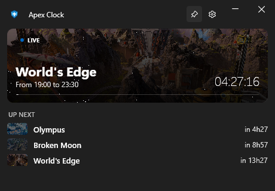
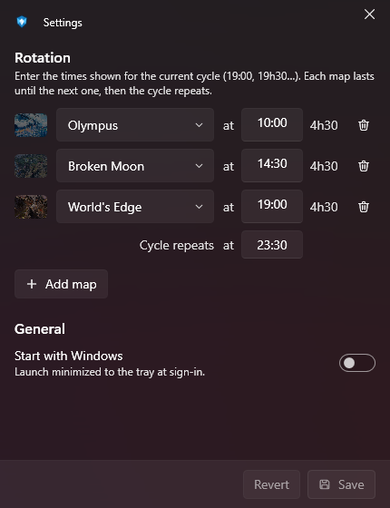

<div align="center">


# Apex Clock

**A tiny Windows companion for the Apex Legends ranked map rotation.**

See the live map at a glance, know what comes next, and get a notification the moment the map changes.




</div>

---

## Features

- **Live map at a glance**: the current ranked map with its artwork, time slot, a live countdown and a progress bar.
- **Up next**: the next three maps and how long until each one goes live.
- **Map change notifications**: a native Windows toast with the map artwork and a short sound every time the rotation moves on.
- **Live tray icon**: the notification area icon shows the initials of the current map inside a ring that fills up as the slot runs out. Hover it for the details, click it to open the companion.
- **Always on top**: pin the companion over your other windows (📌 in the title bar).
- **Runs in the background**: closing the window only hides it to the tray. Notifications and the tray icon keep working.
- **Start with Windows**: launches straight to the tray when you sign in.
- **Fully offline**: no account, no API key, no network. You enter the rotation once and Apex Clock does the math.

## Screenshots

| Companion | Settings |
|:---:|:---:|
|  |  |
| Live map, countdown and the next maps. | Edit the rotation and the app preferences. |

## Installation

1. Install the [.NET 10 Desktop Runtime](https://dotnet.microsoft.com/download/dotnet/10.0) (x64) if you don't have it yet.
2. Download the latest `ApexClock-vX.Y.Z-win-x64.zip` from the [Releases](https://github.com/Neotoxic-off/ApexClock/releases) page.
3. Unzip it anywhere and run `ApexClock.exe`.

Only one copy runs at a time: launching it again just brings the companion back.

## Getting started

Apex Clock does not read the game; it computes the rotation from the times you give it. Setting it up takes a minute:

1. Click ⚙ in the companion (or right-click the tray icon → **Settings**).
2. Under **Rotation**, list the maps of the current cycle in order, with the local time each one goes live. Use the times shown in game or on a rotation site.
3. In **Cycle repeats at**, enter the time the last map ends.
4. Click **Save**. The companion, the tray icon and the notifications update right away.

Times can be typed as `19:00`, `19h30`, `19.30`, `1930`, `19h` or just `19`. The length of each map is shown next to its time (e.g. `4h30`) so you can check your input; an invalid time is outlined in red.

### How the rotation works

Ranked plays a fixed list of maps back to back, then starts over. For example, 3 maps × 4h30 makes a 13h30 cycle:

| Map | Goes live |
|---|---|
| Olympus | 10:00 |
| Broken Moon | 14:30 |
| World's Edge | 19:00 |
| *cycle repeats* | 23:30 |

Because a cycle rarely lasts exactly 24 hours, the times shift from one day to the next; Apex Clock handles that for you. You only need to update the rotation when Respawn changes the map pool at the start of a split.

## Using it

| Where | What it does |
|---|---|
| Companion window | Live map, countdown, the next maps. ⚙ opens the settings, 📌 keeps it on top. |
| Tray icon, left click | Opens the companion. |
| Tray icon, right click | **Open**, **Settings**, **Exit**. |
| Tray icon, hover | Current map, its time slot, time left and the next map. |
| Close button (✕) | Hides the companion; the app keeps running in the tray. Use **Exit** in the tray menu to quit. |

### Settings

- **Rotation**: the maps of the cycle and their start times. **Revert** discards your unsaved edits.
- **Start with Windows**: starts Apex Clock minimized to the tray at sign-in.
- **Old Windows service**: only appears if a version before 1.2 is still installed (see below).

### Upgrading from a version before 1.2

Older versions installed an `ApexClock` Windows service. It is no longer needed: on first run the app imports the rotation saved by the service, and the settings show an **Old Windows service** entry with a **Remove** button. Removing it asks for administrator rights once (the app runs an elevated copy of itself with `--remove-legacy-service`).

## Data and privacy

Apex Clock stores its rotation in `%LocalAppData%\ApexClock\schedule.json` and makes no network requests. **Start with Windows** adds an entry under your user's *Run* registry key; turning it off removes it. To uninstall, turn off **Start with Windows**, quit from the tray menu and delete the folder.

## Building from source

Requirements: Windows 10/11 and the [.NET 10 SDK](https://dotnet.microsoft.com/download/dotnet/10.0).

```powershell
git clone https://github.com/Neotoxic-off/ApexClock.git
cd ApexClock
dotnet build "Apex Clock/Apex Clock.slnx"
dotnet test  "Apex Clock/Apex Clock.slnx"
dotnet run --project "Apex Clock/Apex Clock"
```

Publish a release build:

```powershell
dotnet publish "Apex Clock/Apex Clock" -c Release -r win-x64 --self-contained false
```

### Project layout

| Project | Role |
|---|---|
| `Apex Clock` | The WPF tray app: companion and settings windows (WPF-UI Fluent design, MVVM with CommunityToolkit.Mvvm), live tray icon, toast notifications. |
| `ApexClock.Core` | The rotation model: `RotationSchedule` (an anchor plus slot durations), `RotationCycle` (a cycle as wall-clock times) and `ClockTime`. No UI dependency. |
| `ApexClock.Core.Tests`, `ApexClock.App.Tests` | xUnit tests for the rotation model, the schedule store and the rotation editor. |

### Architecture

- **Composition root**: `App.xaml.cs` wires everything with `Microsoft.Extensions.DependencyInjection`.
- **Clock**: `ClockTicker` publishes a `ClockTickMessage` every second through the MVVM Toolkit messenger. Time comes from an injected `TimeProvider`, so tests can control it.
- **Background behaviour** does not depend on any window: `TrayPresenter` keeps the tray icon and tooltip up to date, `MapChangeNotifier` raises a toast when the live map changes.
- **Storage**: `IScheduleStore` (`JsonScheduleStore`) loads and saves the schedule and announces changes with `ScheduleChangedMessage`.
- **View models**: `MainViewModel` drives the companion (`LiveRotationViewModel`); `SettingsWindowViewModel` groups `RotationEditorViewModel`, `SettingsViewModel` and `LegacyServiceViewModel`. `ISettingsWindowService` opens the settings window from the companion or the tray.

### Notifications

Notifications are native Windows toasts showing the app logo and the map artwork. Unpackaged apps cannot attach a custom sound to a toast, so the toast itself is silent and the app plays `Assets/Sounds/rotation.wav`, only while Windows notifications are enabled.

### Map artwork

`Apex Clock/Assets/Maps/*.jpg` are the Apex Legends map key arts, resized from the images served by apexlegendsstatus.com. Files are named after the map in lowercase with dashes and no apostrophes (`worlds-edge.jpg`); a map without a matching file falls back to a neutral gradient.

## Disclaimer

Apex Clock is a fan-made tool, not affiliated with or endorsed by Electronic Arts or Respawn Entertainment. Apex Legends and its map artwork are © Electronic Arts Inc.
